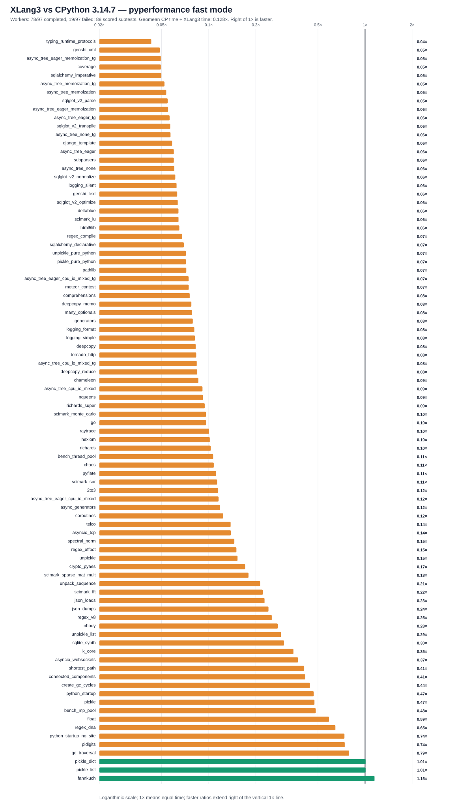

# XLang3 vs CPython 3.14.7: corrected full pyperformance run

The XLang3 run attempted all **97** pyperformance 1.14.0 definitions in `--fast` mode. Its workers completed **78** definitions and recorded **19** failures/timeouts. Benchmark failures make the suite unsuccessful; every definition was attempted.

Of **88** matched subtests, XLang3 was faster on **3**. The geometric mean of CPython time divided by XLang3 time was **0.12801×**; values over 1× favor XLang3. Fast-mode samples carry stability warnings and are directional evidence.

## Run configuration

- XLang3 Release executable SHA-256: `31A9C307298A41B8498CD5FD5E4E2EC3BBD19296975A7C63E587F5CD10DCAB3B`.
- XLang3 runtime DLL SHA-256: `C277CB7A2CAC0F7571626B0307361DD70DE6C775AA61099CDB4CA979CD584DEB`.
- CPython reference: pyperformance 1.14.0 on CPython 3.14.7; XLang3 loaded `Python 3.14 standard library`.
- The XLang3 `PYTHONPATH` contains the Windows pyperf compatibility shim and the shared benchmark dependency site-packages. No Python 3.13 standard-library overlay was used.
- Each XLang3 benchmark definition had a 300-second cap covering pyperf worker calibration and measurement. Overrides: networkx*=600s.

## Largest slowdowns and wins

| Subtest | CPython 3.14.7 | XLang3 | CPython / XLang3 |
|---|---:|---:|---:|
| `typing_runtime_protocols` | 128.1 µs | 2.982 ms | 0.043× |
| `genshi_xml` | 42.5 ms | 871.2 ms | 0.049× |
| `async_tree_eager_memoization_tg` | 266 ms | 5382 ms | 0.049× |
| `coverage` | 65.51 ms | 1325 ms | 0.049× |
| `sqlalchemy_imperative` | 11.24 ms | 225.4 ms | 0.050× |

Nominal timing wins (not proof of statistical significance or correctness):

- `fannkuch`: **1.150×** (275.9 ms vs 317.2 ms).
- `pickle_list`: **1.008×** (3.992 µs vs 4.024 µs).
- `pickle_dict`: **1.008×** (23.42 µs vs 23.59 µs).

## Failure breakdown

- 8 definitions: Benchmark died.
- 11 definitions: Benchmark timed out.

The [all-97 status CSV](data/pyperformance-xlang3-current-vs-cpython3147-full-fast-20261011-r1-all-97-status.csv) retains every benchmark definition and failure status. The [matched subtest CSV](data/pyperformance-xlang3-current-vs-cpython3147-full-fast-20261011-r1-subtests.csv) contains raw per-subtest means and speed ratios.
Partial values from failed definitions remain in raw evidence and are excluded from timing tables, speed ratios and aggregate statistics.

## Raw evidence

- XLang3 pyperf JSON: [`pyperformance-xlang3-current-candidate-full-fast-20261010-r1.json`](data/pyperformance-xlang3-current-candidate-full-fast-20261010-r1.json).
- Runner status log: [`pyperformance-xlang3-current-candidate-full-fast-20261010-r1.log`](data/pyperformance-xlang3-current-candidate-full-fast-20261010-r1.log).
- CPython 3.14.7 pyperf JSON: [`pyperformance-cpython3147-live-eval-full-fast-20261007.json`](data/pyperformance-cpython3147-live-eval-full-fast-20261007.json).
- Earlier runs that used a Python 3.13 standard library are retained separately; this run supersedes them as the same-version Python 3.14 comparison.

Benchmark worker failures have several causes, including unavailable optional benchmark dependencies, XLang3 native-module gaps, and interpreter compatibility bugs. The status CSV gives case-level failure details, and the runner log preserves worker tracebacks when available. A worker death is not a performance score; inspect its case-specific cause before treating it as a speed result.
