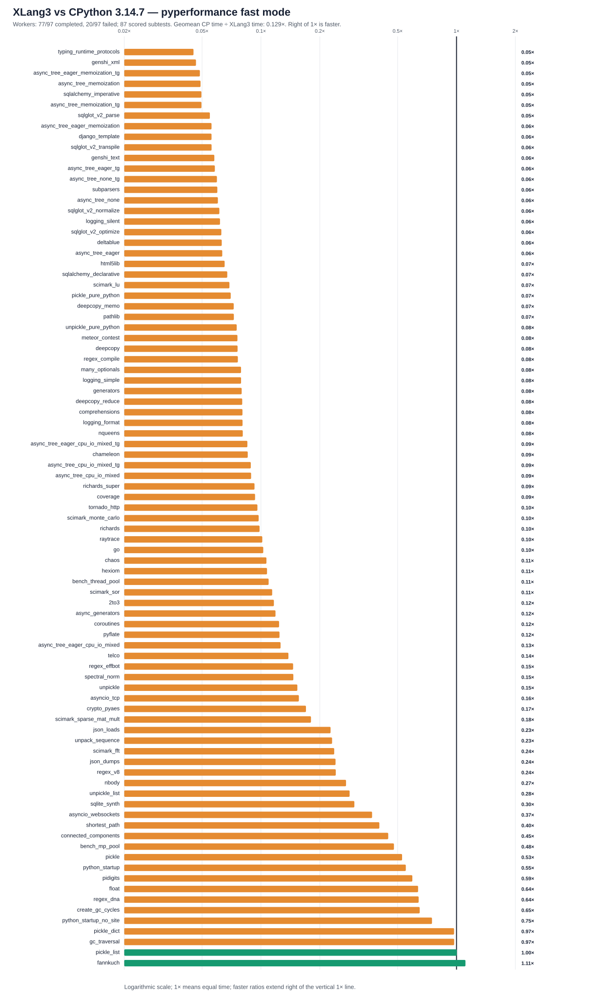

# XLang3 vs CPython 3.14.7: corrected full pyperformance run

The XLang3 run attempted all **97** pyperformance 1.14.0 definitions in `--fast` mode. Its workers completed **77** definitions and recorded **20** failures/timeouts. Benchmark failures make the suite unsuccessful; every definition was attempted.

Of **87** matched subtests, XLang3 was faster on **2**. The geometric mean of CPython time divided by XLang3 time was **0.12922×**; values over 1× favor XLang3. Fast-mode samples carry stability warnings and are directional evidence.

## Run configuration

- XLang3 Release executable SHA-256: `BE0E00D5875D5887B1C7B9345066B82E9DDA450C75FD62AFF8614823A1B7F97B`.
- XLang3 runtime DLL SHA-256: `E4C8ACE7413DC3782AC62513733EE664D3394BD942E666A126E9201711758249`.
- CPython reference: pyperformance 1.14.0 on CPython 3.14.7; XLang3 loaded `Python 3.14 standard library`.
- The XLang3 `PYTHONPATH` contains the Windows pyperf compatibility shim and the shared benchmark dependency site-packages. No Python 3.13 standard-library overlay was used.
- Each XLang3 benchmark definition had a 300-second cap covering pyperf worker calibration and measurement. Overrides: networkx*=600.

## Largest slowdowns and wins

| Subtest | CPython 3.14.7 | XLang3 | CPython / XLang3 |
|---|---:|---:|---:|
| `typing_runtime_protocols` | 128.1 µs | 2.834 ms | 0.045× |
| `genshi_xml` | 42.5 ms | 913.2 ms | 0.047× |
| `async_tree_eager_memoization_tg` | 266 ms | 5457 ms | 0.049× |
| `async_tree_memoization` | 278.5 ms | 5672 ms | 0.049× |
| `sqlalchemy_imperative` | 11.24 ms | 226.5 ms | 0.050× |

Nominal timing wins (not proof of statistical significance or correctness):

- `fannkuch`: **1.111×** (285.4 ms vs 317.2 ms).
- `pickle_list`: **1.004×** (4.01 µs vs 4.024 µs).

## Failure breakdown

- 6 definitions: Benchmark died.
- 14 definitions: Benchmark timed out.

The [all-97 status CSV](data/pyperformance-xlang3-fixed-release-full-fast-shimmed-20261011-r2-vs-cpython3147-all-97-status.csv) retains every benchmark definition and failure status. The [matched subtest CSV](data/pyperformance-xlang3-fixed-release-full-fast-shimmed-20261011-r2-vs-cpython3147-subtests.csv) contains raw per-subtest means and speed ratios.
Partial values from failed definitions remain in raw evidence and are excluded from timing tables, speed ratios and aggregate statistics.

## Raw evidence

- XLang3 pyperf JSON: [`pyperformance-xlang3-fixed-release-full-fast-shimmed-20261011-r2.json`](data/pyperformance-xlang3-fixed-release-full-fast-shimmed-20261011-r2.json).
- Runner status log: [`pyperformance-xlang3-fixed-release-full-fast-shimmed-20261011-r2.log`](data/pyperformance-xlang3-fixed-release-full-fast-shimmed-20261011-r2.log).
- CPython 3.14.7 pyperf JSON: [`pyperformance-cpython3147-live-eval-full-fast-20261007.json`](data/pyperformance-cpython3147-live-eval-full-fast-20261007.json).
- Earlier runs that used a Python 3.13 standard library are retained separately; this run supersedes them as the same-version Python 3.14 comparison.

Benchmark worker failures have several causes, including unavailable optional benchmark dependencies, XLang3 native-module gaps, and interpreter compatibility bugs. The status CSV gives case-level failure details, and the runner log preserves worker tracebacks when available. A worker death is not a performance score; inspect its case-specific cause before treating it as a speed result.

- Fresh CPython status log: [`pyperformance-cpython3147-live-eval-full-fast-20261007.log`](data/pyperformance-cpython3147-live-eval-full-fast-20261007.log).
