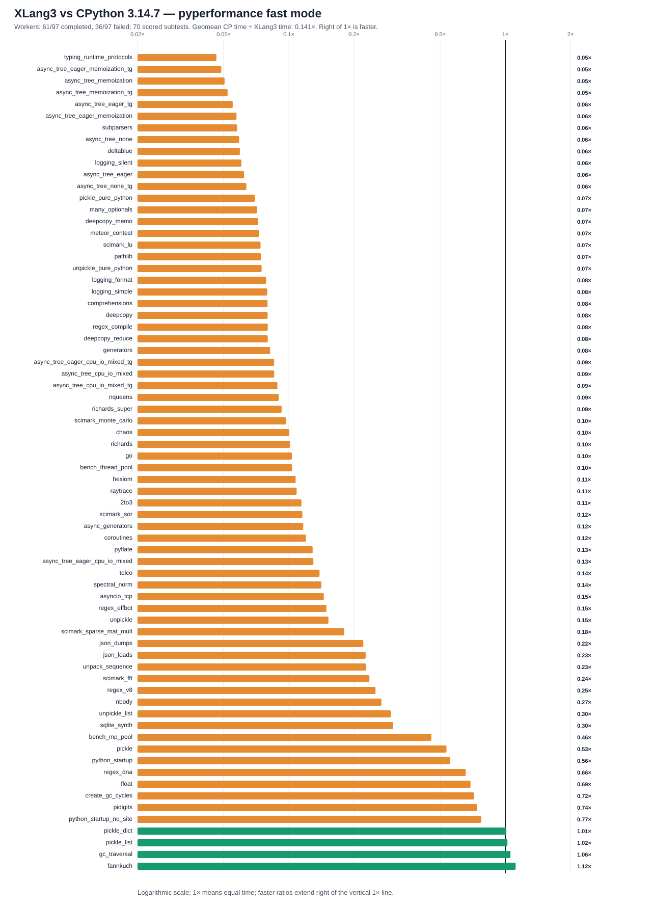

# XLang3 vs CPython 3.14.7: corrected full pyperformance run

The XLang3 run attempted all **97** pyperformance 1.14.0 definitions in `--fast` mode. Its workers completed **61** definitions and recorded **36** failures/timeouts. Benchmark failures make the suite unsuccessful; every definition was attempted.

Of **70** matched subtests, XLang3 was nominally faster on **4** (none is a material overall gain). The geometric mean of CPython time divided by XLang3 time was **0.14068×**, equivalent to XLang3 taking **7.11× longer** across the matched set. A value above 1× in the ratio column favors XLang3. Fast-mode samples carry stability warnings, so this is directional evidence.

## Run configuration

- XLang3 Release executable SHA-256: `B0D96D9E3EA5575C097776545BF378B1B311F97D45A62E73962764DC44FCDC2E`.
- XLang3 runtime DLL SHA-256: `4C799996C3A3741D62209E5D62A8D9D7DBDEE466E2E96910F98C988B49B3F6B8`.
- CPython reference: pyperformance 1.14.0 on CPython 3.14.7; XLang3 loaded `C:\Python\Python314\Lib`.
- The XLang3 `PYTHONPATH` contains the Windows pyperf compatibility shim and the shared benchmark dependency site-packages. No Python 3.13 standard-library overlay was used.
- Each XLang3 benchmark definition had a 300-second cap covering pyperf worker calibration and measurement. Overrides: none.

## Largest slowdowns and wins

| Subtest | CPython 3.14.7 | XLang3 | CPython / XLang3 |
|---|---:|---:|---:|
| `typing_runtime_protocols` | 128.1 µs | 2.768 ms | 0.046× |
| `async_tree_eager_memoization_tg` | 266 ms | 5459 ms | 0.049× |
| `async_tree_memoization` | 278.5 ms | 5519 ms | 0.050× |
| `async_tree_memoization_tg` | 275.8 ms | 5289 ms | 0.052× |
| `async_tree_eager_tg` | 193.1 ms | 3507 ms | 0.055× |

Nominal timing wins (not proof of statistical significance or correctness):

- `fannkuch`: **1.116×** (284.3 ms vs 317.2 ms).
- `gc_traversal`: **1.056×** (2.027 ms vs 2.14 ms).
- `pickle_list`: **1.023×** (3.935 µs vs 4.024 µs).
- `pickle_dict`: **1.011×** (23.33 µs vs 23.59 µs).

## Failure breakdown

- 26 definitions: Benchmark died.
- 10 definitions timed out; 26 benchmark workers died. The 97-case status CSV lists each definition. Live output excerpts identified missing optional packages for 21 worker deaths; the remaining 5 died without a preserved traceback.

The [all-97 status CSV](data/pyperformance-xlang3-fixed-release-r3-vs-cpython3147-full-fast-20261011-all-97-status.csv) retains every benchmark definition and failure status. The [matched subtest CSV](data/pyperformance-xlang3-fixed-release-r3-vs-cpython3147-full-fast-20261011-subtests.csv) contains raw per-subtest means and speed ratios.
Partial values from failed definitions are excluded from timing tables, speed ratios, and the aggregate. The saved partial results include `base64`, `pprint`, and `xml_etree` subtests.

## Raw evidence

- XLang3 pyperf JSON: [`pyperformance-xlang3-fixed-release-full-fast-shimmed-20261011-r3.pyperf.json`](data/pyperformance-xlang3-fixed-release-full-fast-shimmed-20261011-r3.pyperf.json).
- Reconstructed 97-case status index: [`pyperformance-xlang3-fixed-release-full-fast-shimmed-20261011-r3-status-reconstructed.txt`](data/pyperformance-xlang3-fixed-release-full-fast-shimmed-20261011-r3-status-reconstructed.txt). It is not the raw runner transcript; the full worker tracebacks were not saved.
- CPython 3.14.7 pyperf JSON: [`pyperformance-cpython3147-live-eval-full-fast-20261007.json`](data/pyperformance-cpython3147-live-eval-full-fast-20261007.json).
- Timed-out partial pyperf data: [`base64`](data/pyperformance-xlang3-fixed-release-full-fast-shimmed-20261011-r3.pyperf-partial/base64-543e9d1efa788584.json), [`pprint`](data/pyperformance-xlang3-fixed-release-full-fast-shimmed-20261011-r3.pyperf-partial/pprint-09c37ba9ede710b6.json), and [`xml_etree`](data/pyperformance-xlang3-fixed-release-full-fast-shimmed-20261011-r3.pyperf-partial/xml_etree-049c8c1108732d3c.json).
- Earlier runs that used a Python 3.13 standard library are retained separately; this run supersedes them as the same-version Python 3.14 comparison.

Benchmark worker failures include missing optional packages and other worker deaths. The status CSV records which definitions completed, timed out, or died; it includes the missing-package tracebacks preserved from live output. A worker death is not a performance score.
