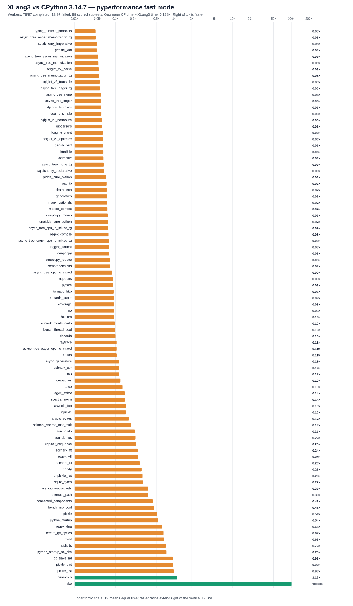

# XLang3 vs CPython 3.14.7: corrected full pyperformance run

The XLang3 run attempted all **97** pyperformance 1.14.0 definitions in `--fast` mode. Its workers completed **78** definitions and recorded **19** failures/timeouts. Benchmark failures make the suite unsuccessful; every definition was attempted.

Of **88** matched subtests, XLang3 was faster on **2**. The geometric mean of CPython time divided by XLang3 time was **0.13780×**; values over 1× favor XLang3. Fast-mode samples carry stability warnings and are directional evidence.

## Run configuration

- XLang3 Release executable SHA-256: `163A6D2059F5E5FC7A9EF21D7C9EF901EFC0D32F36BCFF3BDB8397F15C950B93`.
- XLang3 runtime DLL SHA-256: `9E435A106AAB07891757CE155F79FB1783E6E86831771FE6F41D7ECFE7CF67E0`.
- CPython reference: pyperformance 1.14.0 on CPython 3.14.7; XLang3 loaded `Python 3.14 standard library`.
- The primary all-97 pass used the raw Python 3.14 site-packages. Because that site lacked optional benchmark packages, 26 affected definitions were supplemented with the prepared CPython 3.14.7 dependency site used for the saved control. The raw primary and supplement outputs remain separate; the combined JSON includes their distinct timed subtests. No Python 3.13 standard-library overlay was used.
- The primary run capped each definition at 300 seconds. Supplemented definitions used the same cap, with `networkx*` at 600 seconds.

## Change versus the previous full XLang3 run

On the same **87** subtests present in the previous XLang3 full run and the
CPython reference, the prior CPython/XLang3 geometric mean was 0.12922× and
the candidate was 0.12775×. This is about **1.2% slower** overall, within the
noise expected from separate fast-mode runs. The same-subtest matrix is in
[`pyperformance-xlang3-getitem-inline-vs-prior-common-20261011-r2.md`](data/pyperformance-xlang3-getitem-inline-vs-prior-common-20261011-r2.md).
The SciMark group comparison does show LU 3.37× faster than the saved XLang3
control, but that local win has not produced an overall full-suite gain.

## Largest slowdowns and wins

| Subtest | CPython 3.14.7 | XLang3 | CPython / XLang3 |
|---|---:|---:|---:|
| `typing_runtime_protocols` | 128.1 µs | 2.78 ms | 0.046× |
| `async_tree_eager_memoization_tg` | 266 ms | 5723 ms | 0.046× |
| `sqlalchemy_imperative` | 11.24 ms | 234.3 ms | 0.048× |
| `genshi_xml` | 42.5 ms | 876.7 ms | 0.048× |
| `async_tree_eager_memoization` | 187.5 ms | 3688 ms | 0.051× |

Nominal timing wins (not proof of statistical significance or correctness):

- `mako`: **100.601×** (78 µs vs 7.847 ms).
- `fannkuch`: **1.133×** (280 ms vs 317.2 ms).

## Failure breakdown

- 6 definitions: Benchmark died.
- 13 definitions: Benchmark timed out.

The [all-97 status CSV](data/pyperformance-xlang3-getitem-inline-full-fast-20261011-r2-all-97-status.csv) retains every benchmark definition and failure status. The [matched subtest CSV](data/pyperformance-xlang3-getitem-inline-full-fast-20261011-r2-subtests.csv) contains raw per-subtest means and speed ratios.
Partial values from failed definitions remain in raw evidence and are excluded from timing tables, speed ratios and aggregate statistics.

## Raw evidence

- XLang3 pyperf JSON: [`pyperformance-xlang3-getitem-inline-full-fast-20261011-r2-combined.pyperf.json`](data/pyperformance-xlang3-getitem-inline-full-fast-20261011-r2-combined.pyperf.json).
- Runner status log: [`pyperformance-xlang3-getitem-inline-full-fast-20261011-r2-combined.log`](data/pyperformance-xlang3-getitem-inline-full-fast-20261011-r2-combined.log).
- Combined-run provenance and the two source-run identities: [`pyperformance-xlang3-getitem-inline-full-fast-20261011-r2-combined.provenance.json`](data/pyperformance-xlang3-getitem-inline-full-fast-20261011-r2-combined.provenance.json).
- CPython 3.14.7 pyperf JSON: [`pyperformance-cpython3147-live-eval-full-fast-20261007.json`](data/pyperformance-cpython3147-live-eval-full-fast-20261007.json).
- Earlier runs that used a Python 3.13 standard library are retained separately; this run supersedes them as the same-version Python 3.14 comparison.

Benchmark worker failures have several causes, including unavailable optional benchmark dependencies, XLang3 native-module gaps, and interpreter compatibility bugs. The status CSV gives case-level failure details, and the runner log preserves worker tracebacks when available. A worker death is not a performance score; inspect its case-specific cause before treating it as a speed result.
