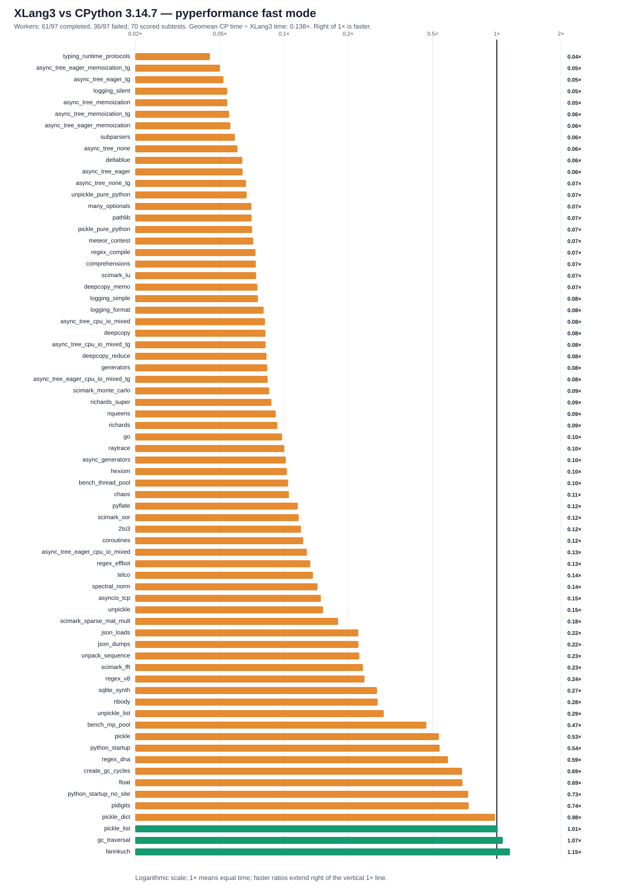

# XLang3 vs CPython 3.14.7: corrected full pyperformance run

The XLang3 run attempted all **97** pyperformance 1.14.0 definitions in `--fast` mode. Its workers completed **61** definitions and recorded **36** failures/timeouts. Benchmark failures make the suite unsuccessful; every definition was attempted.

Of **70** matched subtests, XLang3 was faster on **3**. The geometric mean of CPython time divided by XLang3 time was **0.13820×**; values over 1× favor XLang3. Fast-mode samples carry stability warnings and are directional evidence.

## Run configuration

- XLang3 Release executable SHA-256: `B05A7A9FED6C971613AB88C33B37466DB82A07D7DE16310B8785BCBF7E17B59D`.
- XLang3 runtime DLL SHA-256: `07B2B5DFF897871625BDD95D54DA8B40CB5E5A19E4756E363D540008E6958178`.
- CPython reference: pyperformance 1.14.0 on CPython 3.14.7; XLang3 loaded `Python 3.14 standard library`.
- The XLang3 `PYTHONPATH` contains the Windows pyperf compatibility shim and the shared benchmark dependency site-packages. No Python 3.13 standard-library overlay was used.
- Each XLang3 benchmark definition had a 300-second cap covering pyperf worker calibration and measurement. Overrides: none.

## Largest slowdowns and wins

| Subtest | CPython 3.14.7 | XLang3 | CPython / XLang3 |
|---|---:|---:|---:|
| `typing_runtime_protocols` | 128.1 µs | 2.856 ms | 0.045× |
| `async_tree_eager_memoization_tg` | 266 ms | 5316 ms | 0.050× |
| `async_tree_eager_tg` | 193.1 ms | 3716 ms | 0.052× |
| `logging_silent` | 69.12 ns | 1.277 µs | 0.054× |
| `async_tree_memoization` | 278.5 ms | 5142 ms | 0.054× |

Nominal timing wins (not proof of statistical significance or correctness):

- `fannkuch`: **1.153×** (275.1 ms vs 317.2 ms).
- `gc_traversal`: **1.067×** (2.006 ms vs 2.14 ms).
- `pickle_list`: **1.010×** (3.984 µs vs 4.024 µs).

## Failure breakdown

- 26 definitions: Benchmark died.
- 10 definitions: Benchmark timed out.

The [all-97 status CSV](data/pyperformance-xlang3-isinstance-call-cache-full-fast-20261011-vs-cpython3147-all-97-status.csv) retains every benchmark definition and failure status. The [matched subtest CSV](data/pyperformance-xlang3-isinstance-call-cache-full-fast-20261011-vs-cpython3147-subtests.csv) contains raw per-subtest means and speed ratios.
Partial values from failed definitions remain in raw evidence and are excluded from timing tables, speed ratios and aggregate statistics.

## Raw evidence

- XLang3 pyperf JSON: [`pyperformance-xlang3-isinstance-call-cache-full-fast-20261011.json`](data/pyperformance-xlang3-isinstance-call-cache-full-fast-20261011.json).
- Runner status log: [`pyperformance-xlang3-isinstance-call-cache-full-fast-20261011.log`](data/pyperformance-xlang3-isinstance-call-cache-full-fast-20261011.log).
- CPython 3.14.7 pyperf JSON: [`pyperformance-cpython3147-live-eval-full-fast-20261007.json`](data/pyperformance-cpython3147-live-eval-full-fast-20261007.json).
- Earlier runs that used a Python 3.13 standard library are retained separately; this run supersedes them as the same-version Python 3.14 comparison.

Benchmark worker failures have several causes, including unavailable optional benchmark dependencies, XLang3 native-module gaps, and interpreter compatibility bugs. The status CSV gives case-level failure details, and the runner log preserves worker tracebacks when available. A worker death is not a performance score; inspect its case-specific cause before treating it as a speed result.

- Fresh CPython status log: [`pyperformance-cpython3147-live-eval-full-fast-20261007.log`](data/pyperformance-cpython3147-live-eval-full-fast-20261007.log).
