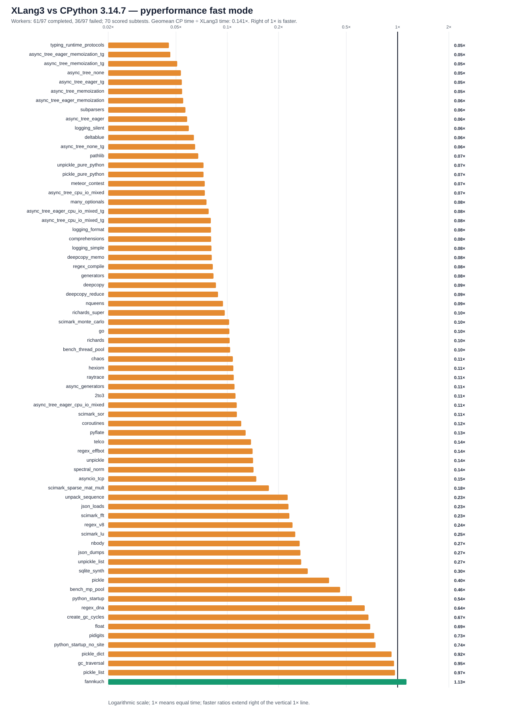

# Complete source handoff checkpoint — 2026-10-12

The user paused further performance optimization to finish this write-up and
move the job to another computer. This checkpoint publishes the current live
engine source, its build dependencies, tests, diagnostics and trial evidence
together. It follows `568523e5` (the Context.run source subset) and `dc92b00d`
(the portable agent prompt), and includes the remaining source changes that
were still local after those commits.

Fresh validation on the fixed Windows Release path passed **55/55 CTest tests**,
the complete Python fixture runner (**432 core cases, 11 compatibility sections
and three expected-failure checks**), and **all 11 default performance-gate
cases**. This is a complete source checkpoint for continuing the job. The
goal of substantially beating CPython 3.14.7 remains unmet and paused.

## Source included

The checkpoint contains actual source changes under `src`, `modules`, `tests`
and `benchmarks`, plus their CMake integration. The [source manifest](data/source-transfer-checkpoint-source-manifest-20261012.json)
identifies the pending source changes by working-file and staged Git hashes.
Required new files include `native_trace_hook.h`, `native_trace_hook.cpp` and
the native `coverage.tracer` module; CMake includes the two new implementation
files. Native runtime code and headers are committed together with their callers.

| Area | Preserved work |
|---|---|
| Python calls and VM frames | Single-star varargs binding, guarded closure arithmetic, cached trivial-call eligibility, closure-frame reuse and versioned builtin/global lookup |
| Eval and observation | Compiled eval entry on the active VM stack, owned eval-local scope tokens, native coverage trace delivery, live trace locals and monitoring invalidation coverage |
| Containers and object protocols | Guarded Python/native subscription paths, dictionary string lookup caches, dictionary-subclass keyword expansion, nested tuple/set hashing, descriptor invalidation and callable generic aliases |
| Class and compiler behavior | Executed class-loop namespaces, live future-annotation dictionaries, stable public MRO tuple identity, required MRO ownership and cycle-collector edges |
| Native runtime modules | Guarded native AttributeError construction, weak-reference target/lifetime handling, native rich-comparison callbacks, small integer byte conversion, socket send sizing, Windows SemLock and psutil contracts |
| Diagnostics and tests | New regression fixtures and expected outputs, fixture-runner registrations, call/opcode profiling helpers and the benchmark-runner compatibility-path fix |

The final correctness repair before the pause lets tagged booleans expose
inherited integer methods in both direct method calls and saved bound-method
lookup. The small-byte-conversion fixture now checks `True.to_bytes`,
`False.to_bytes`, a saved boolean conversion method and boolean `bit_length`.
The previous full Python fixture failure at `True.to_bytes` is resolved in this
checkpoint. No further engine changes were made after the user paused the goal.

Pure-Python libraries remain Python. The native work implements XLang3's own
runtime/native-module interfaces; it does not substitute CPython's runtime or
rewrite pure-Python application libraries in C++. Memory management still
requires reference ownership and cycle handling. The public MRO tuple change
explicitly preserves its collector edges.

## Performance outcome

The latest corrected full-suite evidence is the earlier [r5 comparison](pyperformance-xlang3-fixed-release-full-fast-shimmed-20261011-r5-vs-cpython3147.md),
not a fresh full-suite run of this source checkpoint:

| Historical r5 measure | Result |
|---|---:|
| pyperformance version | 1.14.0 |
| Definitions attempted | 97 |
| Definitions completed | 61 |
| Failures / timeouts | 36 |
| Completed matched subtests | 70 |
| Nominal XLang3 wins | 1 |
| Geometric mean speed, CPython time / XLang3 time | 0.14125x |
| Equivalent elapsed-time gap | About 7.1x slower |

The [all-97 status table](data/pyperformance-xlang3-fixed-release-full-fast-shimmed-20261011-r5-vs-cpython3147-all-97-status.csv)
and [matched timing table](data/pyperformance-xlang3-fixed-release-full-fast-shimmed-20261011-r5-vs-cpython3147-subtests.csv)
retain the denominator and failure outcomes. Failed partial results are excluded
from the timing aggregate. Fast-mode warnings limit the precision of these
historical comparisons. The nominal fannkuch win does not establish an overall win.

Some narrow improvements are preserved, with their limits:

| Mechanism | Recorded result | Scope and limitation |
|---|---|---|
| One exact tuple passed through native Context.run | About 1.25x in a focused diagnostic | Aggregate candidate/control source differs; official async-tree result was insignificant. See [record](context-run-tuple-star-fastpath-trial-20261012.md). |
| Single-star varargs binding | About 1.85x in the paired call-shape diagnostic | Removes duplicate argument packing for one signature shape; no demonstrated broad async-tree win. See [triage record](candidate-hotpath-triage-20261011.md). |
| Guarded one-cell closure arithmetic | 4.13x in sequential local measurements | Candidate still 2.09x slower than CPython on that shape; not a full-suite gain. See [record](closure-binary-inline-trial-20261011.md). |
| Cached canonical isinstance(index, tuple) | About 1.10x on official SciMark LU | A targeted LU gain; other SciMark cases largely unchanged. See [triage record](candidate-hotpath-triage-20261011.md). |
| Compiled eval on the active VM stack | Directional reductions in Genshi text/XML | Independent noisy measurements do not isolate a robust speedup. See [record](compiled-eval-frame-trial-20261010.md). |

Many attempted shortcuts had insignificant results or regressions and were
removed. Their records, including the rejected array, dictionary, LRU, call
and weak-reference trials, are included so the next agent can inspect the
evidence and avoid repeating them. A record of a rejected trial does not mean
its experimental implementation remains in the live engine.

## Findings and unresolved cause

Historical local measurements put a simple integer loop around 1.3x CPython's
time while ordinary call and dictionary work cost several times more. More
complex calls, object protocols, async tasks and numeric-array loops retain
larger gaps. Indexed names and immediate scalar Values reduce particular costs,
but do not remove frame setup, guards, helper dispatch, ownership work and the
remaining instructions executed by each workload.

The [August evidence review](august-to-current-speed-evidence-20261010.md)
found no official supported pyperformance case at checkpoint `8beae11d`.
August custom microbenchmark wins do not supply a comparable full-suite
baseline. The current interpreter and that August version both use switch
dispatch; this fact alone does not identify the cause of the slowdown.

The investigation has localized several costs, but has not proved a single
cause explaining the full gap. The [IR execution / AsmJit document](../ir_execution_performance_asmjit.md)
is an architectural experiment proposal. No AsmJit backend was implemented or
validated in this work. After an explicit resume, the next agent should rank
costs by measured workload time and test shared execution mechanisms on official
cases before accepting another isolated microbenchmark shortcut.

## Validation and provenance

The original run path remains
`build-repro/main-verify-20261006/Release/xlang3.exe`. The build used the
established [VC-environment command](data/vm-active-code-view-reproduction-build-command-20261009.cmd).
CPython was `C:\Python\Python314\python.exe`, version **3.14.7**.

- [Release build log](data/source-transfer-checkpoint-build-20261012.log): exit 0.
- [Full Python fixture log](data/source-transfer-checkpoint-fixtures-20261012.log): exit 0;
  this runner is silent on success. The [receipt](data/source-transfer-checkpoint-validation-20261012.json)
  records the invocation, counts and binary identities.
- [Release CTest log](data/source-transfer-checkpoint-ctest-20261012.log): 55/55 passed,
  including the Visual Studio debugpy launch test that failed in an earlier run.
  That earlier failure remains historical evidence; this successful rerun does
  not establish its original cause.
- [Default performance-gate arrays](data/source-transfer-checkpoint-fixed-release-gate-20261012.json)
  and [console log](data/source-transfer-checkpoint-fixed-release-gate-20261012.log):
  all 11 cases passed at 21 repeats, five warmups and the unchanged 0.10 threshold,
  against the preserved r5 executable and runtime DLL.

The tested executable SHA-256 is
`5731c010c761f1cd7d784ee6a9671e7ad923f3f2789cc9359f046176cb67d9ce`;
the runtime DLL SHA-256 is
`7ca4686aad1e1d17f2a5d97d3aa1672bb5e8adb9ea6ea980455ae078fd498e83`.
Passing this gate protects the accepted local baseline. It does not mean
August speed has been restored or CPython has been beaten.

## Resume on another computer

Clone or update GitHub `main`, read [the portable agent prompt](performance-goal-agent-prompt.md)
and this checkpoint, and establish that computer's CPython 3.14.7 and fixed
Release paths. Build from the committed live sources and create fresh local
baselines. The original Windows binaries, build directories, package caches
and unlinked scratch artifacts are not part of the source checkpoint. The
published reports and linked evidence are available for reading; historical
Windows timings must not be treated as the new computer's measurements.

The current user instruction is to pause optimization and finish the write-up.
Resume optimization only when the user asks to continue, using the portable
prompt's implementation and validation rules.
